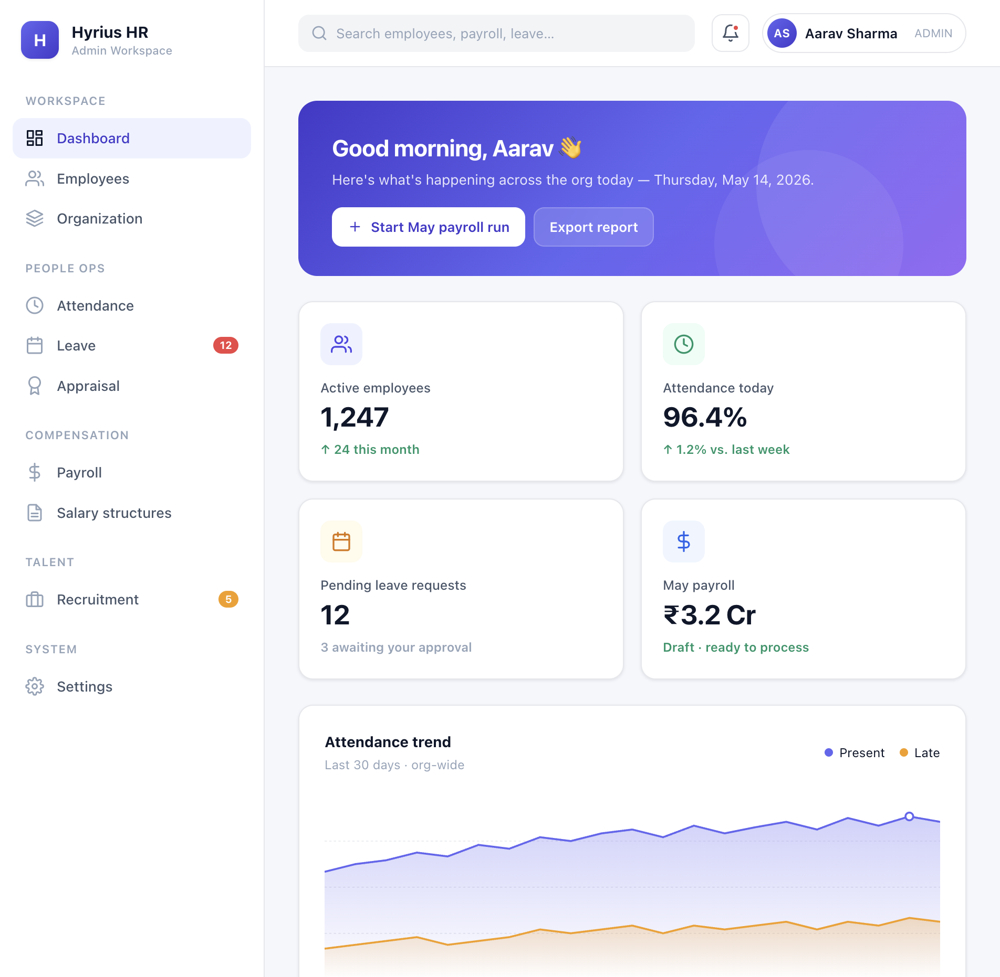

# HRMS & Employee Payroll Management — Backend

> A complete REST API for an HRMS and Payroll Management application built with **Node.js, Express.js, TypeScript, Sequelize ORM** and **MySQL**.
>
> **Author:** Wishvanath Sah  
> **License:** MIT (see [LICENSE](./LICENSE))

Complete REST API for an HRMS and Payroll Management application built with **Node.js, Express.js, TypeScript, Sequelize ORM** and **MySQL**.

Development starts apply migrations automatically. Production starts require a separate migration release step to avoid concurrent instances changing the schema at the same time.

## Dashboard Preview

Admin dashboard design prototype (static mockup):



[Open the dashboard mockup](figma-design/dashboard/admin.html) · [Browse all design screens](figma-design/index.html)

## Tech Stack

| Layer            | Tool                                    |
| ---------------- | --------------------------------------- |
| Runtime          | Node.js (>= 20)                         |
| Web framework    | Express.js 4                            |
| Language         | TypeScript (strict)                     |
| ORM              | Sequelize 6                             |
| Database         | MySQL 8                                 |
| Migration runner | Umzug (programmatic + CLI)              |
| Auth             | JWT (`jsonwebtoken`) + bcryptjs         |
| Validation       | Joi                                     |
| Logging          | Winston + morgan                        |
| Security         | helmet, cors, compression, rate-limit   |
| Status codes     | `http-status-codes`                     |
| Testing          | Jest + ts-jest + supertest              |
| Lint / format    | ESLint + Prettier (husky + lint-staged) |

## Quick Start

```bash
# 1. Install + scaffold .env (also installs husky hooks)
npm run setup

# 2. Set DB_PASSWORD in .env, then create the empty database
mysql -u root -p -e "CREATE DATABASE hrms_payroll CHARACTER SET utf8mb4 COLLATE utf8mb4_unicode_ci;"

# 3. Start the dev server (port 5000)
# Migrations auto-run on boot. Set AUTO_SEED=true the first time for dummy data + seeded logins.
AUTO_SEED=true npm run dev

# …or do it all in one go on a fresh clone:
npm run first-run
```

API root: **http://localhost:5000/api/v1**

## Authentication

Every request to `/api/v1/*` requires a Bearer JWT — **except** the `/auth/*` open endpoints (`/auth/login` and `/auth/refresh`).

### Seeded credentials (after `AUTO_SEED=true`)

| Role(s)               | Email                       | Password       |
| --------------------- | --------------------------- | -------------- |
| `ADMIN`               | `admin@company.com`         | `Admin@123`    |
| `MANAGER`, `EMPLOYEE` | `aarav.sharma@company.com`  | `Password@123` |
| `HR`, `EMPLOYEE`      | `vikram.singh@company.com`  | `Password@123` |
| `EMPLOYEE`            | every other seeded employee | `Password@123` |

Bootstrap admin password can be overridden with `BOOTSTRAP_ADMIN_PASSWORD` before running seeders.

### Auth endpoints

```
POST  /api/v1/auth/login              # open — { email, password } → { user, tokens }
POST  /api/v1/auth/refresh            # open — { refreshToken } → fresh token pair
GET   /api/v1/auth/me                 # current user + roles
POST  /api/v1/auth/change-password    # { oldPassword, newPassword }
POST  /api/v1/auth/logout             # stateless — client just drops its tokens
POST  /api/v1/auth/register           # ADMIN or HR only — creates a login for an existing employee
```

### Usage examples

```bash
# 1. Log in to get an access + refresh token pair
curl -X POST http://localhost:5000/api/v1/auth/login \
  -H 'Content-Type: application/json' \
  -d '{"email":"admin@company.com","password":"Admin@123"}'

# Response:
# {
#   "success": true, "statusCode": 200, "message": "Logged in",
#   "data": {
#     "user": { "userId": 1, "employeeId": null, "email": "admin@company.com", "roles": ["ADMIN"] },
#     "tokens": { "accessToken": "eyJ...", "refreshToken": "eyJ..." }
#   }
# }

# 2. Use the accessToken on every subsequent call
curl http://localhost:5000/api/v1/employees \
  -H 'Authorization: Bearer <accessToken>'

# 3. Renew tokens before the access token expires
curl -X POST http://localhost:5000/api/v1/auth/refresh \
  -H 'Content-Type: application/json' \
  -d '{"refreshToken":"<refreshToken>"}'

# 4. Inspect the current user
curl http://localhost:5000/api/v1/auth/me \
  -H 'Authorization: Bearer <accessToken>'

# 5. Change password
curl -X POST http://localhost:5000/api/v1/auth/change-password \
  -H 'Authorization: Bearer <accessToken>' \
  -H 'Content-Type: application/json' \
  -d '{"oldPassword":"Admin@123","newPassword":"NewStrongPw!2026"}'

# 6. ADMIN or HR provisions a login for an existing employee
curl -X POST http://localhost:5000/api/v1/auth/register \
  -H 'Authorization: Bearer <adminAccessToken>' \
  -H 'Content-Type: application/json' \
  -d '{
        "email": "newhire@company.com",
        "password": "TempPw@2026",
        "employeeId": 11,
        "roles": ["EMPLOYEE"]
      }'
```

### Role-based access control

Available roles: `ADMIN`, `HR`, `MANAGER`, `EMPLOYEE`. A user can hold multiple roles (e.g. `["MANAGER", "EMPLOYEE"]`).

Globally, every `/api/v1/*` route is gated by `authenticate`. To restrict a specific endpoint further, chain `requireRoles(...)`:

```ts
import { authenticate, requireRoles } from '../../../middlewares';

router.delete(
    '/:id',
    authenticate, // already applied at the v1 router level, but explicit here is fine
    requireRoles('ADMIN'), // only ADMIN can hit this route
    catchAsync(controller.remove),
);

// Multiple allowed roles — pass them as separate args:
router.post('/some-leave-action', requireRoles('ADMIN', 'HR'), handler);
```

### Auth-related env vars

```dotenv
# .env (rotate the secrets in any non-dev environment)
JWT_SECRET=change-me-access-secret
JWT_EXPIRES_IN=1h
JWT_REFRESH_SECRET=change-me-refresh-secret
JWT_REFRESH_EXPIRES_IN=7d
BCRYPT_ROUNDS=10

# Used only by the bootstrap-admin seeder
BOOTSTRAP_ADMIN_PASSWORD=Admin@123
```

## Auto-migration on startup

In development, `src/server.ts` does this on startup by default. Set `AUTO_MIGRATE=false` to skip it:

1. `await testConnection()` — confirms MySQL is reachable.
2. `await runPendingMigrations()` — applies any **new** migrations from `src/migrations/`. Already-executed ones are skipped (tracked in `SequelizeMeta`).
3. (Optional) `await runPendingSeeders()` if `AUTO_SEED=true` — tracked in `SequelizeSeeds`.
4. `app.listen(5000)`.

Adding a new migration file under `src/migrations/` and restarting the development server applies it. Production disables automatic migrations by default; run them as a release step before starting the new application version.

## Deployment Guide

### Prerequisites

- Node.js 20 or the provided Docker image.
- A reachable MySQL 8 database with the `hrms_payroll` schema created using `utf8mb4`.
- A dedicated database account. Do not use MySQL `root`; the account needs the schema permissions required by both the app and its migrations.
- A secret manager or deployment environment settings for credentials. Do not put production secrets in the image or commit them to the repository.

### Configure the service

Set these required variables in the deployment platform:

| Variable                                       | Requirement                                                                         |
| ---------------------------------------------- | ----------------------------------------------------------------------------------- |
| `NODE_ENV`                                     | `production`                                                                        |
| `DB_HOST`, `DB_USER`, `DB_PASSWORD`, `DB_NAME` | MySQL connection; use a dedicated user                                              |
| `JWT_SECRET`, `JWT_REFRESH_SECRET`             | Different random secrets, at least 32 characters each                               |
| `CORS_ORIGIN`                                  | Exact allowed browser origin, for example `https://hr.example.com`; `*` is rejected |

`DB_PORT` defaults to `3306`; `PORT` defaults to `5000`. Configure `BOOTSTRAP_ADMIN_PASSWORD` only for first-time bootstrap, with a unique value of at least 16 characters. Production rejects missing or placeholder secrets, root DB access, invalid boolean/numeric settings, and `AUTO_SEED=true`. Automatic migrations default off so application replicas cannot race schema changes.

### Build and release

Run the release steps in order, using the same build artifact for migration and service startup:

```bash
npm ci
npm run verify
npm run build
npm run db:migrate:prod
# First database provisioning only; set BOOTSTRAP_ADMIN_PASSWORD securely first.
npm run db:seed:prod
npm start
```

Run the seed command only when provisioning a new database. In production it creates the standard roles and bootstrap administrator only; it does not insert demo employees or shared employee passwords. The destructive `db:reset` command is disabled in production.

### Docker deployment

Build the image from the repository root:

```bash
docker build -t hrms-payroll-api .
```

The image uses Node.js 20, includes production dependencies and compiled runtime files only, and runs as the unprivileged `node` user. Provide database credentials, JWT secrets, and CORS settings at runtime through the platform's secret manager. Do not bake a `.env` file into the image.

Before starting or replacing service replicas, run one release job from the image to apply migrations. For a local Docker deployment, provide the production settings in an untracked `.env` file and run:

```bash
docker run --rm --env-file .env hrms-payroll-api npm run db:migrate:prod
# First database provisioning only; .env must also contain BOOTSTRAP_ADMIN_PASSWORD.
docker run --rm --env-file .env hrms-payroll-api npm run db:seed:prod
docker run -d --name hrms-payroll-api --env-file .env -p 5000:5000 hrms-payroll-api
```

On a deployment platform, use its release-job and secret-management features for the same migration and optional one-time seed commands. Start the service replicas only after the migration job succeeds; expose the configured port (default `5000`).

Configure the platform readiness probe to call `GET /api/v1/health`; it returns `503` if MySQL is unreachable. After deployment, verify this probe is healthy and test `POST /api/v1/auth/login` with the bootstrap administrator credentials, then rotate that password.

## Project Structure

```
src/
├── api/
│   └── v1/                       # Versioned API surface (/api/v1)
│       ├── controllers/          # 24 controller files — req/res only
│       ├── routes/               # 24 route files + index.ts (auth gate wired here)
│       ├── validators/           # Joi schemas (body / query / params)
│       └── index.ts              # v1 router aggregator
├── config/
│   ├── database.ts               # Sequelize instance
│   ├── env.ts                    # Parsed environment vars (incl. JWT config)
│   ├── logger.ts                 # Winston logger + morgan stream
│   └── sequelize.config.js       # sequelize-cli compatible config
├── constants/                    # HTTP messages, default pagination, etc.
├── db/
│   ├── migrator.ts               # Umzug instances (migrations + seeders)
│   └── cli.ts                    # CLI used by npm scripts
├── middlewares/
│   ├── authenticate.ts           # JWT verify → attaches req.user
│   ├── requireRoles.ts           # role-guard factory
│   ├── catchAsync.ts             # async wrapper
│   ├── errorHandler.ts           # global error → JSON envelope (Sequelize-aware)
│   ├── validate.ts               # Joi-based request validator
│   ├── requestId.ts              # X-Request-Id correlation
│   ├── requestLogger.ts          # morgan → winston
│   └── rateLimiter.ts            # 300 req/min/IP
├── models/                       # 26 Sequelize models incl. User/Role/UserRole
├── migrations/                   # 27 Sequelize migrations
├── seeders/                      # 9 seeders (incl. roles + bootstrap admin)
├── services/                     # 24 services — business logic only
├── utils/
│   ├── ApiError.ts               # operational error class
│   ├── ApiResponse.ts            # consistent success envelope
│   └── pagination.ts             # page/limit/offset parsing
├── app.ts                        # Express app composition
└── server.ts                     # Entry: bootstrap → migrate → listen
```

## Request Flow

```
HTTP request
   ↓
authenticate         (every /api/v1/* except /auth/login + /auth/refresh)
   ↓
Route                src/api/v1/routes/<entity>.route.ts        (path → middleware chain)
   ↓
Validator            Joi schema in src/api/v1/validators/...    (req.body/query/params)
   ↓
requireRoles(...)    (optional, per-endpoint role gate)
   ↓
Controller           src/api/v1/controllers/<entity>.controller (parse → call service → ApiResponse)
   ↓
Service              src/services/<entity>.service.ts            (business logic + transactions)
   ↓
Model                src/models/<entity>.ts                      (Sequelize Model — DB access)
   ↓
MySQL
```

## Industry-standard REST conventions

**Successful response envelope**

```json
{
  "success": true,
  "statusCode": 200,
  "message": "Fetched successfully",
  "data": { ... },
  "meta": { "pagination": { "page": 1, "limit": 20, "total": 137, "totalPages": 7 } }
}
```

**Error response envelope** — produced exclusively by `ApiError` + the global error handler

```json
{
    "success": false,
    "statusCode": 422,
    "message": "Validation failed",
    "errors": { "body": ["\"email\" must be a valid email"] },
    "requestId": "8a23…-…"
}
```

The error handler also catches Sequelize-specific errors and maps them to clean responses:

| Sequelize error             | HTTP status | Notes                        |
| --------------------------- | ----------- | ---------------------------- |
| `UniqueConstraintError`     | 409         | with offending field names   |
| `ForeignKeyConstraintError` | 400         | with table + fields          |
| `ValidationError`           | 422         | field-level messages         |
| `EmptyResultError`          | 404         |                              |
| `DatabaseError`             | 500         | message hidden in production |

## Scripts

| Command                             | Purpose                                                            |
| ----------------------------------- | ------------------------------------------------------------------ |
| `npm run setup`                     | `npm install` + scaffold `.env` from `.env.example`                |
| `npm run first-run`                 | `setup` + `db:setup` + `dev` (fresh-clone onboarding)              |
| `npm run dev`                       | Start dev server with hot reload + auto-migrate                    |
| `npm run build`                     | Compile TypeScript to `dist/`                                      |
| `npm start`                         | Run compiled output                                                |
| `npm test` / `:watch` / `:coverage` | Jest unit tests                                                    |
| `npm run typecheck`                 | `tsc --noEmit`                                                     |
| `npm run lint` / `lint:fix`         | ESLint (`--max-warnings=0`)                                        |
| `npm run format` / `format:check`   | Prettier                                                           |
| `npm run verify`                    | `typecheck + lint + format:check + test` (same as pre-commit gate) |
| `npm run db:migrate`                | Apply pending migrations (manual)                                  |
| `npm run db:migrate:down`           | Roll back the last migration                                       |
| `npm run db:migrate:status`         | Show executed + pending migrations                                 |
| `npm run db:seed`                   | Apply pending seeders                                              |
| `npm run db:reset`                  | Rollback all → migrate → seed                                      |
| `npm run db:setup`                  | Migrate + seed                                                     |

A husky pre-commit hook runs `lint-staged` (Prettier + ESLint --max-warnings=0) followed by `jest --bail`. Commits abort on any failure.

## Functional Modules (26 Tables)

| Module       | Tables                                                                          |
| ------------ | ------------------------------------------------------------------------------- |
| Auth         | Users, Roles, UserRoles                                                         |
| Organization | Departments, Designations                                                       |
| Employee     | Employees, EmploymentHistory                                                    |
| Attendance   | Shifts, EmployeeShifts, AttendanceLogs                                          |
| Leave        | LeaveTypes, LeaveBalances, LeaveRequests                                        |
| Salary       | SalaryStructures, SalaryComponents, SalaryStructureComponents, EmployeeSalaries |
| Payroll      | PayrollRuns, Payslips, PayslipDetails, StatutoryDeductions                      |
| Recruitment  | JobPostings, Applicants, InterviewStages                                        |
| Appraisal    | AppraisalCycles, EmployeeAppraisals                                             |

## API Reference

The complete [Postman collection](postman/postman-collection.json) contains 158 requests, including request bodies, examples, and token scripts. Import it into Postman to run requests. The collection's `baseUrl` defaults to `http://localhost:5000/api/v1`; all paths below are relative to that URL. IDs and query values shown are examples from the collection. Login and refresh are public; protected requests use the collection-saved access token.

| Module                                                      | Requests |
| ----------------------------------------------------------- | -------: |
| [Health](#health)                                           |        2 |
| [Auth](#auth)                                               |        6 |
| [Departments](#departments)                                 |        9 |
| [Designations](#designations)                               |        6 |
| [Employees](#employees)                                     |        9 |
| [Employment History](#employment-history)                   |        6 |
| [Shifts](#shifts)                                           |        5 |
| [Employee Shifts](#employee-shifts)                         |        7 |
| [Attendance Logs](#attendance-logs)                         |        8 |
| [Leave Types](#leave-types)                                 |        5 |
| [Leave Balances](#leave-balances)                           |        6 |
| [Leave Requests](#leave-requests)                           |        9 |
| [Salary Structures](#salary-structures)                     |        6 |
| [Salary Components](#salary-components)                     |        5 |
| [Salary Structure Components](#salary-structure-components) |        5 |
| [Employee Salaries](#employee-salaries)                     |        6 |
| [Payroll Runs](#payroll-runs)                               |        7 |
| [Payslips](#payslips)                                       |        8 |
| [Payslip Details](#payslip-details)                         |        5 |
| [Statutory Deductions](#statutory-deductions)               |        5 |
| [Job Postings](#job-postings)                               |        8 |
| [Applicants](#applicants)                                   |        6 |
| [Interview Stages](#interview-stages)                       |        7 |
| [Appraisal Cycles](#appraisal-cycles)                       |        6 |
| [Employee Appraisals](#employee-appraisals)                 |        6 |

### Health

<details>
<summary>2 requests</summary>

- `GET /health` — Health check
- `GET /` — API index

</details>

### Auth

<details>
<summary>6 requests</summary>

- `POST /auth/login` — Login (saves tokens)
- `POST /auth/refresh` — Refresh token
- `GET /auth/me` — Me
- `POST /auth/change-password` — Change password
- `POST /auth/logout` — Logout
- `POST /auth/register` — Register user (ADMIN / HR only)

</details>

### Departments

<details>
<summary>9 requests</summary>

- `GET /departments?page=1&limit=20` — List
- `POST /departments` — Create
- `GET /departments/1` — Get by id
- `PUT /departments/1` — Update
- `DELETE /departments/1` — Delete
- `GET /departments/1/employees` — Employees in department
- `GET /departments/1/designations` — Designations in department
- `GET /departments/1/children` — Children (sub-departments)
- `GET /departments/1/full` — Full department details

</details>

### Designations

<details>
<summary>6 requests</summary>

- `GET /designations?page=1&limit=20` — List
- `GET /designations/with-department` — List with department
- `POST /designations` — Create
- `GET /designations/1` — Get by id
- `PUT /designations/1` — Update
- `DELETE /designations/1` — Delete

</details>

### Employees

<details>
<summary>9 requests</summary>

- `GET /employees?page=1&limit=20` — List
- `POST /employees` — Create
- `GET /employees/code/EMP0001` — Get by employee code
- `GET /employees/1` — Get by id
- `PUT /employees/1` — Update
- `DELETE /employees/1` — Delete
- `GET /employees/1/reportees` — Reportees
- `PATCH /employees/1/status` — Set status
- `GET /employees/1/profile` — Full profile

</details>

### Employment History

<details>
<summary>6 requests</summary>

- `GET /employment-history?page=1&limit=20` — List
- `POST /employment-history` — Create
- `GET /employment-history/1` — Get by id
- `PUT /employment-history/1` — Update
- `DELETE /employment-history/1` — Delete
- `GET /employment-history/employee/1` — By employee

</details>

### Shifts

<details>
<summary>5 requests</summary>

- `GET /shifts?page=1&limit=20` — List
- `POST /shifts` — Create
- `GET /shifts/1` — Get by id
- `PUT /shifts/1` — Update
- `DELETE /shifts/1` — Delete

</details>

### Employee Shifts

<details>
<summary>7 requests</summary>

- `GET /employee-shifts?page=1&limit=20` — List
- `POST /employee-shifts` — Create
- `GET /employee-shifts/employee/1/current` — Current shift for employee
- `GET /employee-shifts/employee/1/history` — Shift history for employee
- `GET /employee-shifts/1` — Get by id
- `PUT /employee-shifts/1` — Update
- `DELETE /employee-shifts/1` — Delete

</details>

### Attendance Logs

<details>
<summary>8 requests</summary>

- `GET /attendance-logs?page=1&limit=20` — List
- `POST /attendance-logs` — Create
- `POST /attendance-logs/check-in` — Check-in
- `POST /attendance-logs/check-out` — Check-out
- `GET /attendance-logs/summary/1?year=2026&month=5` — Monthly summary
- `GET /attendance-logs/1` — Get by id
- `PUT /attendance-logs/1` — Update
- `DELETE /attendance-logs/1` — Delete

</details>

### Leave Types

<details>
<summary>5 requests</summary>

- `GET /leave-types` — List
- `POST /leave-types` — Create
- `GET /leave-types/1` — Get by id
- `PUT /leave-types/1` — Update
- `DELETE /leave-types/1` — Delete

</details>

### Leave Balances

<details>
<summary>6 requests</summary>

- `GET /leave-balances?page=1&limit=20` — List
- `POST /leave-balances` — Create
- `GET /leave-balances/employee/1?year=2026` — By employee
- `GET /leave-balances/1` — Get by id
- `PUT /leave-balances/1` — Update
- `DELETE /leave-balances/1` — Delete

</details>

### Leave Requests

<details>
<summary>9 requests</summary>

- `GET /leave-requests?page=1&limit=20` — List
- `GET /leave-requests/with-relations?status=PENDING` — List with relations
- `POST /leave-requests` — Create
- `GET /leave-requests/1` — Get by id
- `PUT /leave-requests/1` — Update
- `DELETE /leave-requests/1` — Delete
- `POST /leave-requests/1/approve` — Approve
- `POST /leave-requests/1/reject` — Reject
- `POST /leave-requests/1/cancel` — Cancel

</details>

### Salary Structures

<details>
<summary>6 requests</summary>

- `GET /salary-structures` — List
- `POST /salary-structures` — Create
- `GET /salary-structures/1` — Get by id
- `PUT /salary-structures/1` — Update
- `DELETE /salary-structures/1` — Delete
- `GET /salary-structures/1/components` — With components

</details>

### Salary Components

<details>
<summary>5 requests</summary>

- `GET /salary-components` — List
- `POST /salary-components` — Create
- `GET /salary-components/1` — Get by id
- `PUT /salary-components/1` — Update
- `DELETE /salary-components/1` — Delete

</details>

### Salary Structure Components

<details>
<summary>5 requests</summary>

- `GET /salary-structure-components` — List
- `POST /salary-structure-components` — Create
- `GET /salary-structure-components/1` — Get by id
- `PUT /salary-structure-components/1` — Update
- `DELETE /salary-structure-components/1` — Delete

</details>

### Employee Salaries

<details>
<summary>6 requests</summary>

- `GET /employee-salaries?page=1&limit=20` — List
- `POST /employee-salaries` — Create
- `GET /employee-salaries/employee/1/current` — Current for employee
- `GET /employee-salaries/1` — Get by id
- `PUT /employee-salaries/1` — Update
- `DELETE /employee-salaries/1` — Delete

</details>

### Payroll Runs

<details>
<summary>7 requests</summary>

- `GET /payroll-runs?page=1&limit=20` — List
- `POST /payroll-runs` — Create
- `GET /payroll-runs/1` — Get by id
- `PUT /payroll-runs/1` — Update
- `DELETE /payroll-runs/1` — Delete
- `POST /payroll-runs/1/process` — Process and generate payslips
- `POST /payroll-runs/1/lock` — Lock

</details>

### Payslips

<details>
<summary>8 requests</summary>

- `GET /payslips?page=1&limit=20` — List
- `POST /payslips` — Create
- `GET /payslips/employee/1` — By employee
- `GET /payslips/1/detailed` — Detailed line items and statutory deductions
- `GET /payslips/1` — Get by id
- `PUT /payslips/1` — Update
- `DELETE /payslips/1` — Delete
- `POST /payslips/1/mark-paid` — Mark paid

</details>

### Payslip Details

<details>
<summary>5 requests</summary>

- `GET /payslip-details` — List
- `POST /payslip-details` — Create
- `GET /payslip-details/1` — Get by id
- `PUT /payslip-details/1` — Update
- `DELETE /payslip-details/1` — Delete

</details>

### Statutory Deductions

<details>
<summary>5 requests</summary>

- `GET /statutory-deductions` — List
- `POST /statutory-deductions` — Create
- `GET /statutory-deductions/1` — Get by id
- `PUT /statutory-deductions/1` — Update
- `DELETE /statutory-deductions/1` — Delete

</details>

### Job Postings

<details>
<summary>8 requests</summary>

- `GET /job-postings?page=1&limit=20` — List
- `GET /job-postings/with-relations?status=OPEN` — List with relations
- `POST /job-postings` — Create
- `GET /job-postings/1` — Get by id
- `PUT /job-postings/1` — Update
- `DELETE /job-postings/1` — Delete
- `POST /job-postings/1/close` — Close
- `GET /job-postings/1/applicants` — Applicants for posting

</details>

### Applicants

<details>
<summary>6 requests</summary>

- `GET /applicants?page=1&limit=20` — List
- `POST /applicants` — Create
- `GET /applicants/1` — Get by id
- `PUT /applicants/1` — Update
- `DELETE /applicants/1` — Delete
- `PATCH /applicants/1/status` — Change status

</details>

### Interview Stages

<details>
<summary>7 requests</summary>

- `GET /interview-stages` — List
- `POST /interview-stages` — Create
- `GET /interview-stages/applicant/1` — By applicant
- `GET /interview-stages/1` — Get by id
- `PUT /interview-stages/1` — Update
- `DELETE /interview-stages/1` — Delete
- `POST /interview-stages/1/result` — Record result

</details>

### Appraisal Cycles

<details>
<summary>6 requests</summary>

- `GET /appraisal-cycles` — List
- `POST /appraisal-cycles` — Create
- `GET /appraisal-cycles/1` — Get by id
- `PUT /appraisal-cycles/1` — Update
- `DELETE /appraisal-cycles/1` — Delete
- `GET /appraisal-cycles/1/appraisals` — Appraisals in cycle

</details>

### Employee Appraisals

<details>
<summary>6 requests</summary>

- `GET /employee-appraisals?page=1&limit=20` — List
- `POST /employee-appraisals` — Create
- `GET /employee-appraisals/1` — Get by id
- `PUT /employee-appraisals/1` — Update
- `DELETE /employee-appraisals/1` — Delete
- `POST /employee-appraisals/1/finalize` — Finalize rating

</details>

## Adding a new table

1. Add a model file under `src/models/<entity>.ts` and export it from `src/models/index.ts`.
2. Add associations directly in the model file (the dependent side owns both directions).
3. Add a migration file under `src/migrations/YYYYMMDDhhmmss-create-<entity>.ts`.
4. Write the service, controller, route, validator (one file each).
5. Mount the new route in `src/api/v1/index.ts` under the `guarded` router (or `v1` directly if it must be public).
6. Restart the server — the new migration runs automatically on boot.
7. Add `*.test.ts` next to each new file; the pre-commit hook enforces them.

## License

This project is licensed under the MIT License - see the [LICENSE](./LICENSE) file for details.

**Copyright © 2026 Wishvanath Sah**
